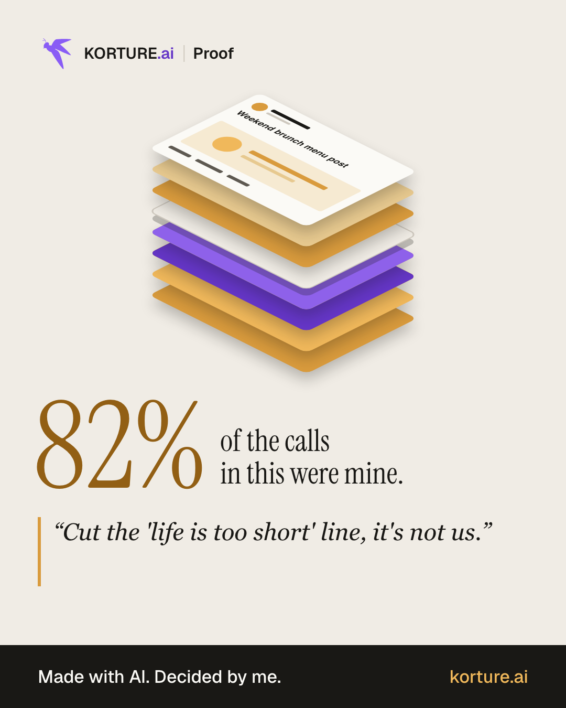
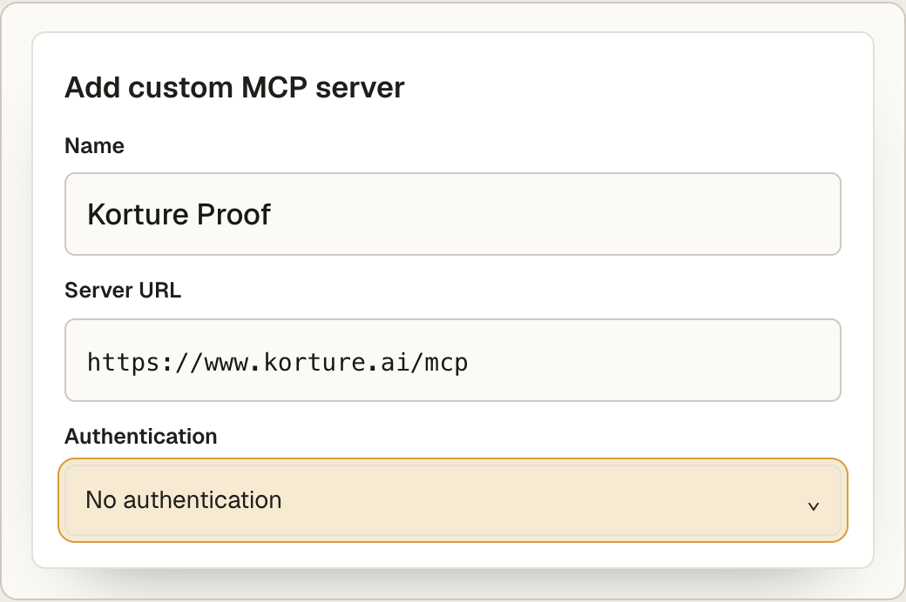

<p align="center"></p>

<h1 align="center">Made with AI. Decided by you.</h1>

<p align="center">Every AI tool measures the AI. Korture measures you, the person using it:<br>your part in the work, your habits, and whether you are getting better.</p>

<p align="center"><a href="https://www.korture.ai"><b>korture.ai</b></a></p>

---

## Why we built this

People told us how working with AI feels:

> "Cool to see my idea come to life, but I didn't write any of it, I didn't struggle, and I didn't learn." ([r/webdev](https://www.reddit.com/r/webdev/comments/1vcbj53/ai_took_away_the_sense_of_pride_i_used_to_have_in/p16o1o7/))

> "Am I actually learning in those situations, or am I just getting better at getting AI to solve problems for me?" ([r/ChatGPTCoding](https://www.reddit.com/r/ChatGPTCoding/comments/1x0bx6a/how_do_you_know_if_youre_actually_learning_when/))

> "write my own answer first, badly, before I open anything" ([r/ArtificialInteligence](https://www.reddit.com/r/ArtificialInteligence/comments/1vrv2wd/has_your_own_reasoning_gotten_weaker_since_you/p4llhbl/))

A script writer does not direct the film or act in it, and actors change lines on set. Everyone still knows whose story it is. Before AI, we worked with templates, books, teams and assistants, and nobody asked us to prove every word was ours.

AI also pulls your way of working in its own direction, a little each day. It guesses what finished looks like. It suggests, and you say yes. That can be fine. These tools show you where it happens, so the direction is your choice.

They are for you, not for the world. There is no score of how human you are.

## What is here

| | Part | What it does | Where it works |
|---|---|---|---|
| **Open** | [Korture Proof](proof/) | After a piece of work with AI, shows your part: the calls you made, your best moments in your own words, and the share of the calls that were yours. | ChatGPT, Claude, Claude Code, Codex, and any AI that reads skills |
| **Open** | [/mode](mode/) | Before a task, say how you want to work with AI: autopilot, copilot or practice. Your AI keeps to it. | Any AI that reads skills |
| **Open to read** | [Sense plugins](sense-plugins/) | How Korture Sense gets into each AI app, and exactly what it reads on your computer. | Needs Korture Sense |
| **Idea** | [Ideas](ideas/) | What good work with AI looks like at each step, and how Sense measures, with the research behind it. | Read anywhere |
| **Experiment** | [Habit map](experiments/habit-map/) | Your AI points out one of your habits, in one line, when it shows up. | Being tried with a few people, not open yet |
| **Private** | Korture Sense | The reader, the scoring and the expert lessons. This is what we sell. | [korture.ai](https://www.korture.ai) |

## Start with Korture Proof

<p align="center"></p>

At the end of a piece of work, say **"show my proof"**. Add it one of three ways:

**Connector**, for ChatGPT and Claude. The page is drawn inside your chat. Add a custom connector (in ChatGPT, a custom MCP server) with this address and no sign-in:

```
https://www.korture.ai/mcp
```

<p align="center"></p>

**Skill**, if you want nothing to leave your chat. Download `korture-proof.zip` from [Releases](../../releases) and upload it to Claude, or copy [`proof/skills/korture-proof`](proof/skills/korture-proof) into your AI's skills folder.

**Plugin**, for Claude Code:

```
/plugin install korture-proof --marketplace korture-ai/korture-ai
```

What Proof keeps: counts only. Your AI reads the chat. With the connector, short quotes pass through our server to draw the page and are not stored. [Read the server code.](proof/server/index.ts)

## What we keep private, and why

Korture Sense reads every message you send to your AI, on your computer, with your own AI, and shows how you work with it over time. The questions it asks, the rules that turn answers into a number, and the expert lessons it teaches are what we sell, so they stay private.

How Sense gets into your apps, and what it reads, is open. A tool that reads your chats should never keep that secret.

How Sense measures, and the research behind it: [ideas/](ideas/).

## License

MIT. See [LICENSE](LICENSE).
