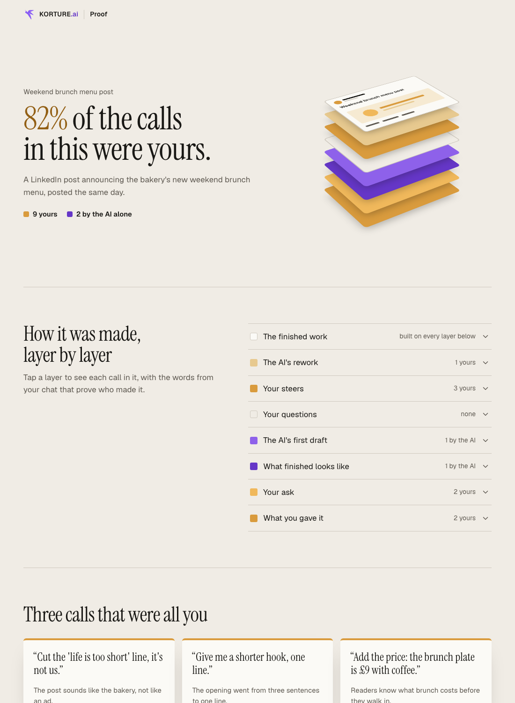

# Korture Proof

You finish something with AI: a post, some code, a story, a report. Then a small voice says, "did I really make this?"

Korture Proof answers with your own words. It reads the chat, finds every call that shaped the finished work, and shows you which ones were yours.

- **N% of the calls in this were yours.** A call is a choice that shaped the work, where a reasonable person could have chosen differently. Saying yes to an idea of the AI's is a choice too, so it counts as yours.
- **The work as eight layers.** What you gave it, your ask, what finished looks like, the first draft, your questions, your steers, the rework, the finished work. Honey for your part, violet for the AI's.
- **Your three best moments.** Your own words, and what each one changed.
- **One layer to make yours next time.** Where the AI decided for you.



## Add it

| Where | How |
|---|---|
| ChatGPT | Settings, Apps or Plugins, add a custom MCP server: `https://www.korture.ai/mcp`, no sign-in |
| Claude (web and desktop) | Settings, Connectors, add a custom connector: `https://www.korture.ai/mcp` |
| Claude Code | `claude mcp add --transport http korture-proof https://www.korture.ai/mcp` |
| Codex | `codex mcp add korture-proof --url https://www.korture.ai/mcp` |
| Any AI that loads skills | Add this folder as a skill. The AI draws the page with `build.py` |

Then say **"show my proof"** when the work is done.

## What leaves your chat

- **Your AI reads the chat.** Korture does not.
- **To draw the page,** your AI sends the calls it found, each with a short quote (at most 25 words), to the Korture server. The server draws the page and does not store the quotes.
- **What Korture stores:** the kind of work, the number of calls, how many were yours, the share, and how many moments were picked. In ChatGPT, also the anonymous user and chat ids ChatGPT passes to every app, and the language setting. Never words from the chat.
- **As a skill,** nothing leaves your chat at all.

You can read all of this in [`server/index.ts`](server/index.ts).

## What is in this folder

| File | What it is |
|---|---|
| `SKILL.md` | The method: what a call is, who made it, the eight layers. Any AI can follow it. |
| `page.html` | The page that draws the result. One file, no outside service. |
| `build.mjs`, `build.py` | Put one result into the page: `python3 build.py example/brunch-post.json proof.html` |
| `example/brunch-post.json` | A made-up example: a bakery's LinkedIn post. |
| `server/` | The MCP server behind `korture.ai/mcp` (Deno). `node server/pack.mjs` packs the page and the method into it. |

## Run your own server

```bash
node server/pack.mjs
deno run --allow-net --allow-env server/index.ts
```

Without `SUPABASE_URL` and `SUPABASE_SERVICE_ROLE_KEY` set, it stores nothing at all.
